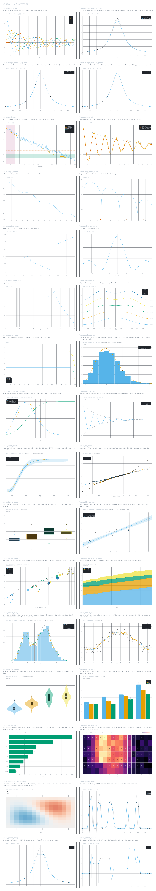

# terminal-sciviz

Live, interactive scientific visualization **inline in the Claude Code chat**, rendered with WebGPU.
Claude decides to show a graphic and it appears between its text: real pixels, full resolution,
on your terminal's own background. You drag to pan or orbit, zoom, hover for values; Claude reads a
snapshot of exactly what you see.



## What's in it

- **A Claude Code plugin** (`sciviz`): tools Claude calls to show images (`show`) and to open live
  views (`gallery_open`, `view`, `plot`); slash commands for you (`/sciviz-gallery`,
  `/sciviz-view`, `/sciviz-open`); and a skill, `terminal-graphics`, that teaches Claude how to
  present graphics well in a terminal (transparent backgrounds, theme colours, native resolution,
  side-by-side comparisons).
- **WebGPU renderers** (`deno/`), headless, one process per kind of view:
  - `line.ts`: 2D lines: linear/log/symlog axes, π and 2ᵏ ticks, PCHIP and spline interpolation,
    envelopes, reference lines and bands, legends, hover read-outs.
  - `curve.ts`: NURBS / B-spline curves in 2D and 3D, colour by value, ODE trajectories (Lorenz).
  - `surface.ts`: NURBS surfaces evaluated in a compute shader, coloured by field, height or curvature.
  - `complex.ts`: domain colouring of complex functions, evaluated per pixel.
  - `volume.ts`: ray-marched volumes and GPU marching-cubes isosurfaces.
  - Function data (Bessel functions, orbitals, …) is generated by compute shaders; text is drawn
    from a signed-distance-field font on the GPU.
- **A gallery** of 38 entries (lines, curves, complex, volumes) that doubles as a regression test.
- `overlay/`: an experimental native macOS window that draws WebGPU straight to the screen over
  the chat at the display's refresh rate.

## Requirements

- A terminal with the kitty graphics protocol. Developed and tested in [Ghostty](https://ghostty.org);
  [kitty](https://sw.kovidgoyal.net/kitty/) implements the same protocol but is untested.
- [Deno](https://deno.com) 2.x, for its built-in WebGPU. If it isn't installed and Homebrew is, the plugin
  runs `brew install deno` itself the first time a session starts. At runtime that's all: no npm packages, no other
  services. (Regenerating the bundled font atlas or colour-map tables uses Python and npm tooling; the
  results are committed, so you never need it to use the plugin.)
- Claude Code **2.1.287 or later** (terminal mods); the `claude plugin install` shell shortcut needs 2.1.292+.
- Developed on macOS (Apple silicon, Metal). Linux should work through Deno's WebGPU (Vulkan) but is untested.

## Install

At the prompt of a Claude Code session:

```
/plugin install sciviz --marketplace https://github.com/NAThompson/terminal-sciviz.git
```

From a shell: `claude plugin install sciviz --marketplace https://github.com/NAThompson/terminal-sciviz.git`.

The full `https://` URL clones the public repository anonymously, so no GitHub account or SSH key is
needed. (The short form `NAThompson/terminal-sciviz` tries SSH first, which fails inside a session on
machines without a GitHub SSH key.)

Then ask Claude to show you something (“plot the Lorenz attractor”, “show the gallery”), or run
`/sciviz-gallery lines` and `/sciviz-view lorenz`.

### Controls in a live view

| Action | 2D views | 3D views |
|---|---|---|
| drag | pan | orbit |
| shift-drag, `+` / `-` | zoom about the pointer | zoom |
| hover | values next to the cursor | values at the surface / ray hit |
| click, then `c` / `C`, `i`, `r` | cycle / invert colour map, reset | same |
| `p`, `,` `.` (4D stacks) | play / pause, step slices | |

## Developing

```
cd deno
deno task gallery          # render every entry and the contact sheets (gallery/out/)
deno task gallery-check    # re-render and diff against gallery/golden/
deno run -A --unstable-webgpu --unstable-ffi line.ts png CONTROL.json -o out.png
```

Each renderer speaks a small protocol (`deno/lib/serve.ts`): the plugin writes `control.json` with an
increasing `rev`; the renderer prints `frame <gen> <w> <h> <shm> <rev>` for each frame (published as a
POSIX shared-memory image) and `snapshot <rev> <path>` once a requested PNG is saved.

## License

MIT, see [LICENSE](LICENSE). Bundled colour-map data and fonts keep their own licences: see [LICENSES/](LICENSES/)
(which lists where each colour map comes from) and the `OFL.txt` beside each font.
